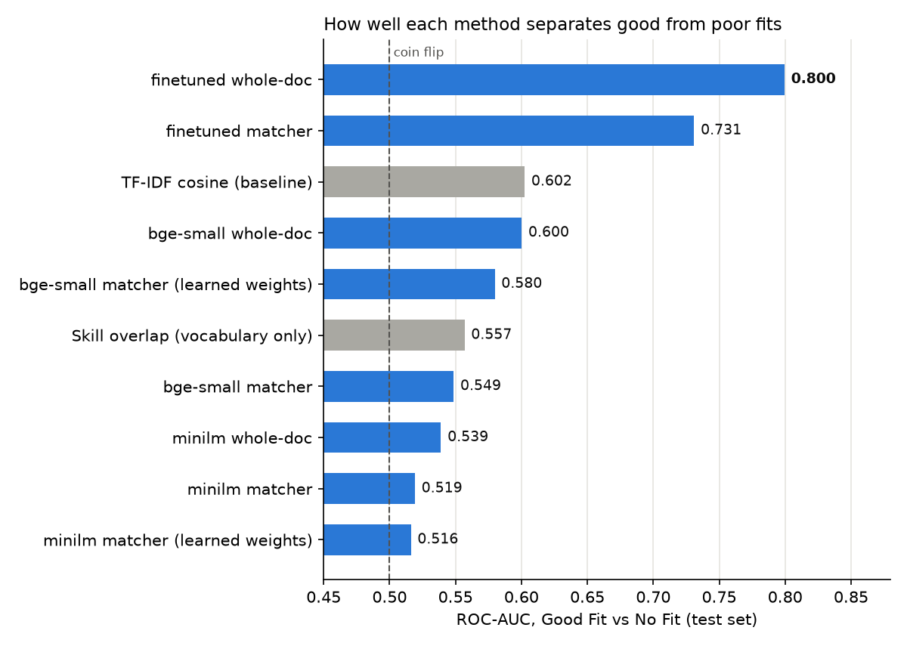
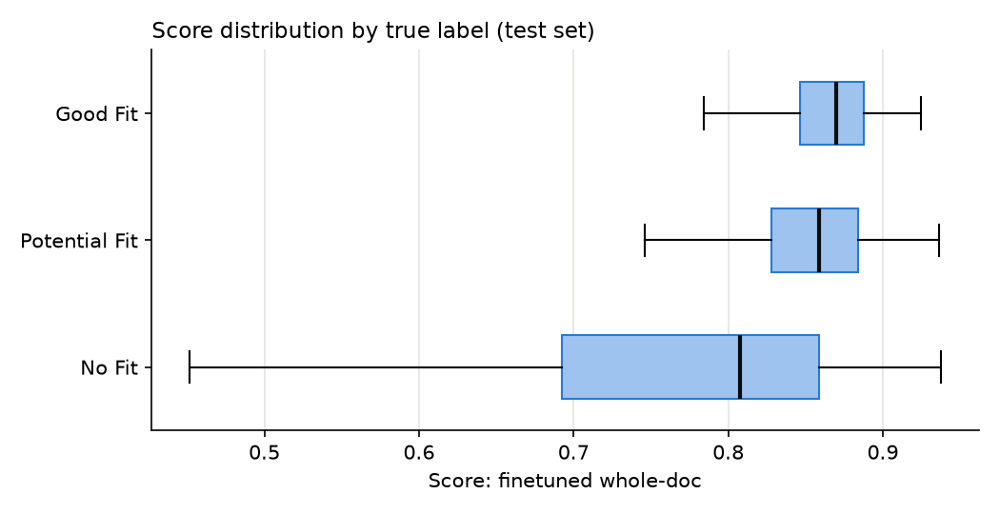

# 📄 Resume ↔ Job Description Matcher

Upload a resume (PDF, DOCX or text) and paste a job description. The app tells you:

- an **overall match score** (0-100),
- **section scores** for skills, experience and education,
- **which resume line supports each job requirement** (and which requirements have no evidence),
- **matched, related and missing skills**, e.g. "the JD asks for *Deep learning*; you list *PyTorch*",
- short **improvement suggestions**.

A second tab **ranks several resumes** against one job description.

Everything runs locally with small open-source transformer models
(`all-MiniLM-L6-v2`, `BAAI/bge-small-en-v1.5`, ~90 MB / ~130 MB).



---

## What are sentence embeddings? (plain words)

A sentence-embedding model reads a piece of text and outputs a list of numbers
(384 of them for the models used here) called an **embedding**. The model was trained
so that texts with *similar meaning* get *similar lists of numbers*, even when they use
different words:

| Text A | Text B | Similar? |
|---|---|---|
| "Built CNNs in PyTorch" | "Experience with deep learning frameworks" | yes, although no word is shared |
| "Built CNNs in PyTorch" | "Managed a retail store" | no |

To compare two texts we measure the angle between their embeddings (**cosine similarity**):
1.0 means "same meaning", around 0 means "unrelated". Keyword search (like TF-IDF) only
counts shared words, so it misses the first example above. That is the main reason to use
embeddings for resumes, where the same skill is described in many ways.

## How the matcher works

```
resume ──► split into bullets/sentences ──► embed each line ─┐
                                                              ├─► for every JD requirement, find the
job description ──► split into requirement lines ──► embed ──┘   most similar resume line (= evidence)

both ──► skill vocabulary (≈150 skills + aliases) ──► matched / related / missing skills
                 │
                 ├─ "implies" rules: PyTorch ⇒ Deep learning, PostgreSQL ⇒ SQL
                 ├─ alternatives: "PyTorch or TensorFlow" – having one is enough
                 └─ fuzzy matching with embeddings for everything else

score = 0.5 × requirement coverage + 0.3 × skill coverage + 0.2 × whole-document similarity
        (fine-tuned model: 0.25 / 0.15 / 0.60)
```

- **Requirement coverage**: average of the best-match similarity of every JD line, mapped to 0-100.
  Each model has its own calibration because their cosine ranges differ
  (`python evaluate.py --calibrate` prints the percentiles used).
- **Skill coverage**: exact match = 1 point, related = ½ point, missing = 0, divided by the number of JD skills.
- **Whole-document similarity**: one embedding for the whole (cleaned) resume vs one for the JD.
  With the fine-tuned model this part gets 60% of the weight, because it is the part trained on fit labels.
- **Sections**: the resume is split into skills / experience / education using headings
  (or, if there are none, by guessing each line), and each section is compared with the matching part of the JD.

## Results

Evaluated on the **test split of
[cnamuangtoun/resume-job-description-fit](https://huggingface.co/datasets/cnamuangtoun/resume-job-description-fit)**:
1,759 real resume/JD pairs labelled *No Fit* (857), *Potential Fit* (444) or *Good Fit* (458).
Test job descriptions never appear in the training split. Full table: [results/metrics.md](results/metrics.md).

| Method | ROC-AUC Good vs No | ROC-AUC Fit vs No | Spearman |
|---|---:|---:|---:|
| TF-IDF cosine (keyword baseline) | 0.602 | 0.586 | 0.153 |
| Skill overlap (vocabulary only) | 0.557 | 0.556 | 0.091 |
| MiniLM, whole document | 0.539 | 0.572 | 0.088 |
| MiniLM, matcher score | 0.519 | 0.559 | 0.061 |
| bge-small, whole document | 0.600 | 0.619 | 0.175 |
| bge-small, matcher score | 0.549 | 0.580 | 0.101 |
| bge-small, matcher with learned weights | 0.580 | 0.606 | 0.148 |
| **MiniLM fine-tuned**, whole document | **0.800** | **0.770** | **0.470** |
| **MiniLM fine-tuned**, matcher score (what the app shows) | 0.731 | 0.726 | 0.371 |

**How to read it.** ROC-AUC is the chance that a randomly picked *Good Fit* pair gets a
higher score than a randomly picked *No Fit* pair (0.5 = coin flip, 1.0 = perfect).

**What we learned**

1. **Off-the-shelf embeddings barely beat a coin flip on this dataset** (0.52-0.60), and no
   better than TF-IDF. Almost every pair in the dataset is from the *same field* (an accountant
   resume against an accounting job labelled "No Fit"), so "is this the same topic?" (what
   general embeddings measure) is not the question being asked.
2. **Fine-tuning fixes that.** Training MiniLM for 6 minutes on the 6,241 labelled training pairs
   (CoSENT loss, 2 epochs, settings fixed before looking at the test set) raises ROC-AUC from
   **0.54 to 0.80** and Spearman from 0.09 to 0.47.
3. The app's combined score (requirements + skills + fine-tuned document similarity) reaches 0.73:
   a bit lower than the raw fine-tuned similarity, because the requirement and skill parts are
   not trained. In exchange the app can *explain* the score (evidence lines, missing skills).
   The app uses the fine-tuned model by default once `finetune.py` has been run.



## Project layout

```
matcher/
  __init__.py   keeps all downloads/temp files inside the project folder
  parsing.py    read PDF/DOCX/TXT, split into chunks and sections
  skills.py     curated skill vocabulary, aliases, "implies" rules
  embedder.py   loads the embedding model (GPU if free, CPU otherwise), caches vectors
  scoring.py    requirement matching, skill matching, scores, suggestions, ranking
  data.py       loads the Hugging Face evaluation dataset
app.py          Gradio web UI (match + rank tabs)
evaluate.py     compares all methods, writes results/
finetune.py     fine-tunes MiniLM on the labelled pairs (optional)
examples/       fictional resumes and job descriptions to try
tests/          pytest tests
```

## How to run

```bash
# 1. create a virtual environment (Python 3.12) and install
py -3.12 -m venv .venv
.venv\Scripts\activate
pip install torch --index-url https://download.pytorch.org/whl/cu126   # GPU build; plain "pip install torch" for CPU
pip install -r requirements.txt

# 2. start the web app, then open http://127.0.0.1:7860
python app.py

# 3. optional: reproduce the evaluation / fine-tuning
python finetune.py          # ~5-10 min on a laptop GPU, saves models/minilm-resume-jd
python evaluate.py          # writes results/metrics.md and the charts
pytest                      # run the tests
```

The first run downloads the models into `.hf_cache/` inside the project.
Set `MATCHER_DEVICE=cpu` to force CPU if your GPU is busy.

## Limitations (honest notes)

- The labelled dataset is noisy and most pairs are from the *same field* (e.g. an accountant
  resume vs an accounting job labelled "No Fit"), so "does this person fit?" is much harder
  than "is this the same field?". Untrained similarity barely predicts the labels.
- The fine-tuned model is better at the overall score but slightly worse at picking the single
  best evidence line (it was trained on whole documents). Switch the dropdown to `minilm` for
  crisper line-level evidence.
- Resumes in train and test overlap (different job descriptions), so the fine-tuned numbers say
  "generalises to new jobs", not necessarily "to new people".
- The skill vocabulary is hand-made and tech/business-focused; skills outside it are only
  covered through line-level semantic matching.
- PDF parsing depends on the PDF having a text layer (scanned images are not OCR'd).
- A score is a screening aid, not a hiring decision.

## Resume bullet ideas

- Built a resume-to-job-description matcher with **sentence-transformer embeddings** that maps each
  job requirement to its best supporting resume line, detects matched/missing skills (≈150-skill
  vocabulary + embedding fuzzy matching) and ranks candidates; shipped as a **Gradio** web app.
- **Fine-tuned MiniLM** on 6.2k labelled resume/JD pairs with a CoSENT ranking loss in 6 minutes on a
  laptop GPU, raising ROC-AUC for separating good from poor fits from **0.54 to 0.80** on held-out
  job descriptions and beating a TF-IDF baseline (0.60).
- Designed an evaluation comparing TF-IDF, two embedding models (MiniLM, BGE-small), a
  logistic-regression score combiner and a fine-tuned model with ROC-AUC and Spearman correlation;
  covered parsing (PDF/DOCX), skill extraction and scoring with pytest.
