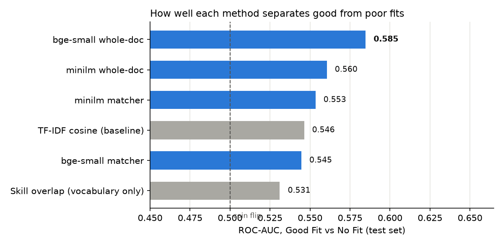
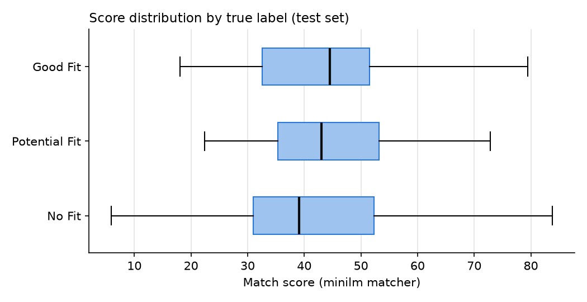

# Evaluation: does the score separate good fits from poor ones?

Dataset: [cnamuangtoun/resume-job-description-fit](https://huggingface.co/datasets/cnamuangtoun/resume-job-description-fit), test split (200 pairs: 98 No Fit, 46 Potential Fit, 56 Good Fit). Test job descriptions never appear in the training split.

| Method | ROC-AUC Good vs No | ROC-AUC Fit vs No | Spearman |
|---|---:|---:|---:|
| TF-IDF cosine (baseline) | 0.546 | 0.515 | 0.055 |
| Skill overlap (vocabulary only) | 0.531 | 0.513 | 0.038 |
| minilm whole-doc | 0.560 | 0.585 | 0.116 |
| minilm matcher | 0.553 | 0.559 | 0.093 |
| bge-small whole-doc | **0.585** | 0.602 | 0.148 |
| bge-small matcher | 0.545 | 0.541 | 0.069 |

*ROC-AUC*: chance that a random better-fitting pair gets a higher score than a random worse one (0.5 = coin flip, 1.0 = perfect). *Spearman*: rank correlation with the 3-level label.

